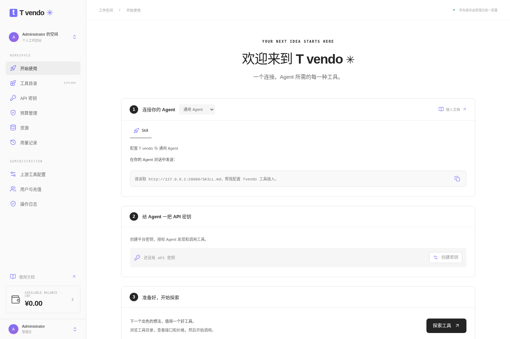

<div align="center">

# T vendo

**让 Agent 方便地发现和调用工具的自托管平台**<br>
统一接入 HTTP 与 MCP 工具，人民币计价、按次计费，使用同一个余额与预算。

[](https://github.com/dyunwei/tvendo/actions/workflows/ci.yml)
[](https://github.com/dyunwei/tvendo/releases)
[](https://hub.docker.com/r/dyunwei/tvendo)
[](https://www.npmjs.com/package/@dyunwei/tvendo)
[](LICENSE)



</div>

## 为什么选择 Tvendo

- **面向 Agent**：用中文查找工具，查看参数和价格，通过 CLI 或 API 调用。
- **统一接入**：管理员配置 HTTP / JSON 或远程 MCP 上游，用户使用平台密钥。
- **费用可控**：人民币固定单次售价、统一余额、预算限制和调用记录。

## 功能

| 功能 | 说明 |
| --- | --- |
| 工具目录 | 工具文本搜索、参数 Schema、输入示例与价格 |
| Agent 接入 | 中文 Skill、Go CLI、REST API |
| 上游管理 | HTTP 配置、MCP 工具同步、批量上下架与定价 |
| 余额与预算 | 余额预留、成功结算、失败退款、单次与每日预算 |
| 用户控制台 | 平台 API Key、用量、钱包与预算设置 |
| 部署 | Docker Compose，PostgreSQL 与 Redis |

## 快速开始

需要 Docker Engine 和 Compose 插件。下载配置并编辑 `.env`：

```sh
mkdir tvendo && cd tvendo
curl -fsSLO https://github.com/dyunwei/tvendo/releases/latest/download/compose.yaml
curl -fsSL https://github.com/dyunwei/tvendo/releases/latest/download/env.example -o .env
```

设置数据库密码、管理员邮箱和密码、`ENCRYPTION_KEY`（用 `openssl rand -hex 32` 生成）与 `PUBLIC_URL`。下载的配置模板已将 `TVENDO_VERSION` 固定为该 Release 的版本，然后启动：

```sh
docker compose pull
docker compose up -d
```

打开 `http://localhost:8080`，用配置的管理员账户登录。添加上游 → 核对参数和价格 → 开放工具 → 给用户充值 → 用户创建平台 API Key。

镜像、npm 包和部署附件在 Release 工作流成功后可用。提前试用可从源码运行 `make source-up`。HTTPS、完整配置、镜像源、升级及备份见 [部署说明](docs/deployment.md)。

## 接入 Agent

把下面这句话发给 Agent：

```text
请读取 https://<你的服务地址>/SKILL.md，帮我配置 Tvendo 工具接入。
```

也可直接安装 CLI，在本机配置 `TVENDO_SERVER` 和 `TVENDO_API_KEY` 后使用：

```sh
npm install -g @dyunwei/tvendo
tvendo doctor --json
tvendo tools search '网页搜索' --json
```

无需全局安装时用 `npx --yes @dyunwei/tvendo --help`。完整配置、二进制安装及调用流程见 [Agent 接入](docs/agent-access.md)。

## 项目状态

当前采用人工充值，支持同步 HTTP / JSON 和远程 MCP 工具调用。工具与供应商凭据由部署管理员配置，不附带现成的付费服务。已知限制与验证范围见 [兼容性](docs/compatibility.md)。

## 文档与贡献

[文档索引](docs/README.md) · [部署](docs/deployment.md) · [Agent 接入](docs/agent-access.md) · [上游管理](docs/upstreams.md) · [API](docs/api.md) · [开发](docs/development.md) · [维护与发布](docs/maintaining.md) · [更新日志](CHANGELOG.md)

欢迎通过 [Issues](https://github.com/dyunwei/tvendo/issues) 和 Pull Requests 参与改进。

## 许可证

Copyright © 2026 dyunwei。

本项目采用 [GNU LGPL v3](LICENSE)（`LGPL-3.0-only`），附带其引用的 [GNU GPL v3 条款](COPYING.GPL-3)。
