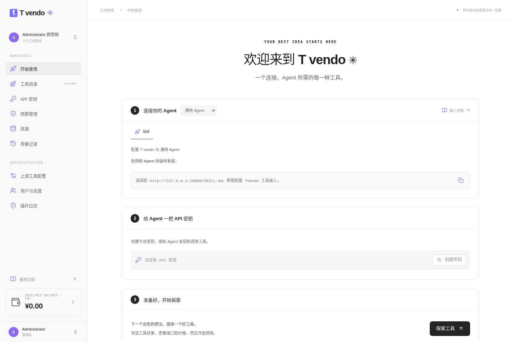

<div align="center">

# T vendo

**让 Agent 方便地发现和调用工具的自托管平台**<br>
统一接入 HTTP 与 MCP 工具，人民币计价、按次计费，使用同一个余额与预算。

[](https://github.com/dyunwei/tvendo/actions/workflows/ci.yml)
[](https://github.com/dyunwei/tvendo/releases)
[](https://hub.docker.com/r/dyunwei/tvendo)
[](https://www.npmjs.com/package/@dyunwei/tvendo)
[](LICENSE)



</div>

## 为什么选择 Tvendo

- **面向 Agent**：用中文描述需求，发现工具、查看参数与价格，通过 Skill、CLI 或 API 接入。
- **统一接入**：管理员配置 HTTP / JSON 或远程 MCP 上游，用户使用平台密钥。
- **费用可控**：人民币固定单次售价、统一余额、单次与每日预算，支持微信扫码充值和人工充值。

## 功能

| 功能 | 说明 |
| --- | --- |
| 工具目录 | 端点能力说明、参数 Schema、输入示例与价格 |
| Agent 工具检索 | 默认关键词搜索；可选跨语言向量召回与 Rerank 重排、相关性过滤、无匹配时推荐网页搜索工具 |
| Agent 接入 | 中文 Skill、Go CLI、REST API、原生 MCP |
| 上游管理 | HTTP 配置、MCP 工具同步、批量上下架与定价 |
| 余额与预算 | 余额预留、成功结算、失败退款、单次与每日预算 |
| 钱包与充值 | 微信 Native 扫码支付、订单状态、自动入账、充值与消费流水；保留管理员人工充值 |
| 用户控制台 | 平台 API Key、调用详情、错误诊断与预算设置 |
| 部署 | Docker Compose，PostgreSQL 与 Redis |

## 快速开始

需要 Docker Engine 和 Compose 插件。下载配置并编辑 `.env`：

```sh
mkdir tvendo && cd tvendo
curl -fsSLO https://github.com/dyunwei/tvendo/releases/latest/download/compose.yaml
curl -fsSL https://github.com/dyunwei/tvendo/releases/latest/download/env.example -o .env
```

设置数据库密码、管理员邮箱和密码、`ENCRYPTION_KEY`（用 `openssl rand -hex 32` 生成）与 `PUBLIC_URL`。下载的配置模板已将 `TVENDO_VERSION` 固定为该 Release 的版本，然后启动：

```sh
docker compose pull
docker compose up -d
```

本机访问 `http://localhost:8080`；远程部署访问配置的 `PUBLIC_URL`。用管理员账户登录，添加上游、核对参数和价格后开放工具。用户充值并创建平台 API Key 后，即可接入 Agent。未开启微信支付时，由管理员人工充值。

镜像、npm 包和部署附件在 Release 工作流成功后可用。提前试用可从源码运行 `make source-up`。HTTPS、完整配置、镜像源、升级及备份见 [部署说明](docs/deployment.md)。

### 可选：开启微信扫码充值

支付默认关闭。需开通微信 Native 支付、配置商户参数与密钥，并填写独立的 HTTPS 回调地址 `WECHAT_PAY_NOTIFY_URL`。下载支付挂载配置：

```sh
curl -fsSLO https://github.com/dyunwei/tvendo/releases/latest/download/compose.wechat.yaml
```

按 [微信支付配置](docs/wechat-pay.md) 完成 `.env` 后，使用两个 Compose 文件启动：

```sh
docker compose -f compose.yaml -f compose.wechat.yaml up -d
```

`WECHAT_PAY_KEYS_DIR` 指向宿主机密钥目录，容器内固定挂载到 `/run/secrets/wechat-pay`；`WECHAT_PAY_PRIVATE_KEY_PATH` 等路径填写容器内文件位置。支持微信支付公钥或平台证书验签，支付确认后自动入账，钱包可查看订单与资金流水。当前使用手机微信扫描二维码，暂不支持手机同机支付。

## 接入 Agent

把下面这句话发给 Agent：

```text
安装 https://<你的服务地址>/SKILL.md 为用户级技能，配置并验证接入。
```

支持远程 Streamable HTTP 的 MCP 客户端可直接连接 `https://<你的服务地址>/mcp`，使用平台 API Key 作为 Bearer 凭据。

也可直接安装 CLI，在本机配置 `TVENDO_SERVER` 和 `TVENDO_API_KEY` 后使用：

```sh
npm install -g @dyunwei/tvendo
tvendo doctor --json
tvendo tools search '网页搜索' --json
```

无需全局安装时用 `npx --yes @dyunwei/tvendo --help`。完整配置、二进制安装及调用流程见 [Agent 接入](docs/agent-access.md)。

## 工具搜索

CLI / API 默认提供关键词检索，可按需接入 Embedding 与 Rerank，让中文需求匹配英文工具描述，并按端点实际能力重排和过滤结果。支持百炼及兼容接口，也可使用自托管 E5 服务；模型服务未配置时无需额外依赖。

没有匹配结果时，可配置 `SEARCH_FALLBACK_TOOL_REF` 推荐目录中已启用的网页搜索端点。推荐单独返回，不会自动调用或产生工具消费。配置示例、模型费用与阈值说明见 [工具目录混合搜索](docs/catalog-search.md)。

## 项目状态

当前支持同步 HTTP / JSON 和远程 MCP 工具调用。工具与供应商凭据由部署管理员配置，不附带现成的付费服务；微信支付及搜索模型均需单独配置。暂不提供异步任务、H5 / JSAPI 同机支付及部分退款。支持范围见 [兼容性](docs/compatibility.md)，测试证据与边界见 [验证记录](docs/verification.md)。

## 文档与贡献

[文档索引](docs/README.md) · [部署](docs/deployment.md) · [Agent 接入](docs/agent-access.md) · [上游管理](docs/upstreams.md) · [工具搜索](docs/catalog-search.md) · [微信支付](docs/wechat-pay.md) · [API](docs/api.md) · [开发](docs/development.md) · [维护与发布](docs/maintaining.md) · [更新日志](CHANGELOG.md)

欢迎通过 [Issues](https://github.com/dyunwei/tvendo/issues) 和 Pull Requests 参与改进。

## 许可证

Copyright © 2026 dyunwei。

本项目采用 [GNU LGPL v3](LICENSE)（`LGPL-3.0-only`），附带其引用的 [GNU GPL v3 条款](COPYING.GPL-3)。
